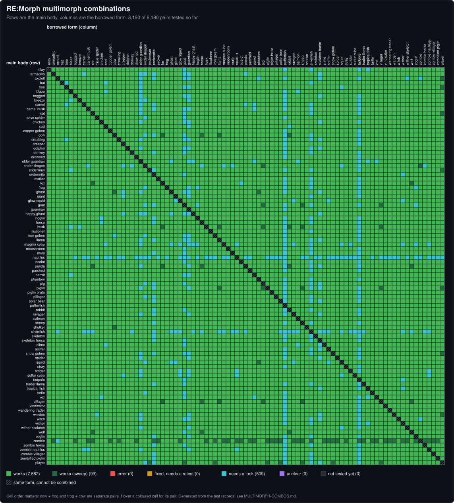

# Multimorph combinations

A multimorph is one morph wearing a piece of another. You keep your main body and borrow a second form's head (or its wings, rods, fins and so on), along with some of its abilities and traits.
Both the look and the abilities get mixed, so every pair is its own small test, and there are a lot of pairs.

## Where testing stands

There are 91 forms: 90 mobs, plus your own player body, which can be the main body or the borrowed one. A form can't borrow from itself (baby and colour variants of one creature count as the same form), so there are 91 x 90 = 8,190 pairs when you count main and borrowed separately. If you ignore which is which, that's 4,095.

Every one of the 8,190 ordered pairs has been tried in some way (4,095 if you ignore which is which). What's left is checking the details, which is where help is most useful.

| Status | What it means | Pairs |
|---|---|---|
| works | Tried and it behaved. Covers the look, the borrowed abilities, or both, as listed in the CSV. | 7,582 |
| works (sweep) | Only seen as part of a broad sweep (the zombie body against every borrowed form, for example), not picked out and checked on its own. | 99 |
| error | Tried and something is wrong. Listed below. (An issue labelled bug turns a square into this on the grid.) | 0 |
| fixed, needs a retest | A bug was found and a fix is in, but nobody has seen the fix work on this pair yet. | 0 |
| needs a look | It does what it should, but I'm not sure it looks right yet. If you can say either way, an issue helps. | 509 |
| unclear | Tried, but the result was not conclusive, or it works as written and it is an open question whether it should. | 0 |
| not tested yet | Nobody has tried it yet. | 0 |

## The grid

**[Open the clickable grid](https://bluecrunchmaican.github.io/RE-Morph-Paper-edition/combos/).** Click a square to report a problem with that pair; the report opens as a GitHub issue with the pair already filled in. The grid also reads the open issues, so a pair someone has just reported shows up as reported, and as an error, a needs a look or a fixed once I've gone through it.

If you can't run scripts in your browser, here is the same grid as a picture, and the pairs one per line in [multimorph-combos.csv](multimorph-combos.csv).

Rows are the main body, columns are the borrowed form. Order matters: a cow wearing a frog's tongue and a frog wearing a cow's head are different pairs, and they can pass or fail separately. The hatched diagonal is a form against itself, which the plugin refuses. Hover a coloured cell to see its pair (if your viewer shows tooltips).

What the labels mean: `mod` is how it looks with the client mod. `no mod` is how it looks to a player who doesn't have the mod. `behaviour` is the abilities, traits and drawbacks. `other checks` is any other test of the pair. A pair can be solid on one and untested on another.

## Errors

None right now. If you find one, click its square on the grid.

## Fixed, needs a retest

None right now. A pair gets this status when I've fixed a bug but nobody has seen the fix work on it yet. A retest usually takes a minute or two.

## Needs a look

509 pairs do what they should, but I can't tell whether the look is right. If you can say either way, an issue helps.

| Main | Borrowed | Version |
|---|---|---|
| allay | goat | 8.0.0-beta.2 |
| allay | pufferfish | 8.0.0-beta.2 |
| allay | silverfish | 8.0.0-beta.2 |
| allay | tadpole | 8.0.0-beta.2 |
| allay | tropical fish | 8.0.0-beta.2 |
| armadillo | camel | 8.0.0-beta.2 |
| armadillo | elder guardian | 8.0.0-beta.2 |
| armadillo | ender dragon | 8.0.0-beta.2 |
| armadillo | endermite | 8.0.0-beta.2 |
| armadillo | goat | 8.0.0-beta.2 |
| armadillo | guardian | 8.0.0-beta.2 |
| armadillo | panda | 8.0.0-beta.2 |
| armadillo | skeleton horse | 8.0.0-beta.2 |
| axolotl | elder guardian | 8.0.0-beta.2 |
| axolotl | endermite | 8.0.0-beta.2 |
| axolotl | goat | 8.0.0-beta.2 |
| axolotl | guardian | 8.0.0-beta.2 |
| axolotl | phantom | 8.0.0-beta.2 |
| axolotl | pufferfish | 8.0.0-beta.2 |
| axolotl | skeleton horse | 8.0.0-beta.2 |
| axolotl | tadpole | 8.0.0-beta.2 |
| axolotl | wither skeleton | 8.0.0-beta.2 |
| axolotl | zombie | 8.0.0-beta.2 |
| bat | bee | 8.0.0-beta.2 |
| bat | cod | 8.0.0-beta.2 |
| bat | elder guardian | 8.0.0-beta.2 |
| bat | silverfish | 8.0.0-beta.2 |
| bee | elder guardian | 8.0.0-beta.2 |
| bee | goat | 8.0.0-beta.2 |
| bee | guardian | 8.0.0-beta.2 |
| bee | squid | 8.0.0-beta.2 |
| blaze | cod | 8.0.0-beta.2 |
| blaze | elder guardian | 8.0.0-beta.2 |
| blaze | pufferfish | 8.0.0-beta.2 |
| blaze | salmon | 8.0.0-beta.2 |
| bogged | elder guardian | 8.0.0-beta.2 |
| bogged | goat | 8.0.0-beta.2 |
| bogged | guardian | 8.0.0-beta.2 |
| bogged | pufferfish | 8.0.0-beta.2 |
| bogged | skeleton horse | 8.0.0-beta.2 |
| bogged | tadpole | 8.0.0-beta.2 |
| breeze | blaze | 8.0.0-beta.2 |
| breeze | elder guardian | 8.0.0-beta.2 |
| breeze | ender dragon | 8.0.0-beta.2 |
| breeze | guardian | 8.0.0-beta.2 |
| breeze | pufferfish | 8.0.0-beta.2 |
| breeze | tadpole | 8.0.0-beta.2 |
| camel | bee | 8.0.0-beta.2 |
| camel | elder guardian | 8.0.0-beta.2 |
| camel | endermite | 8.0.0-beta.2 |
| camel | panda | 8.0.0-beta.2 |
| camel | parrot | 8.0.0-beta.2 |
| camel | pufferfish | 8.0.0-beta.2 |
| camel | silverfish | 8.0.0-beta.2 |
| camel | tadpole | 8.0.0-beta.2 |
| camel husk | elder guardian | 8.0.0-beta.2 |
| camel husk | endermite | 8.0.0-beta.2 |
| camel husk | goat | 8.0.0-beta.2 |
| camel husk | guardian | 8.0.0-beta.2 |
| camel husk | parrot | 8.0.0-beta.2 |
| camel husk | pufferfish | 8.0.0-beta.2 |
| camel husk | silverfish | 8.0.0-beta.2 |
| camel husk | tadpole | 8.0.0-beta.2 |
| cat | elder guardian | 8.0.0-beta.2 |
| cat | goat | 8.0.0-beta.2 |
| cat | silverfish | 8.0.0-beta.2 |
| cat | tadpole | 8.0.0-beta.2 |
| cave spider | ender dragon | 8.0.0-beta.2 |
| cave spider | goat | 8.0.0-beta.2 |
| cave spider | pufferfish | 8.0.0-beta.2 |
| chicken | elder guardian | 8.0.0-beta.2 |
| chicken | goat | 8.0.0-beta.2 |
| chicken | guardian | 8.0.0-beta.2 |
| chicken | skeleton horse | 8.0.0-beta.2 |
| chicken | tadpole | 8.0.0-beta.2 |
| cod | guardian | 8.0.0-beta.2 |
| cod | rabbit | 8.0.0-beta.2 |
| copper golem | pufferfish | 8.0.0-beta.2 |
| copper golem | tadpole | 8.0.0-beta.2 |
| cow | ender dragon | 8.0.0-beta.2 |
| cow | endermite | 8.0.0-beta.2 |
| cow | goat | 8.0.0-beta.2 |
| cow | pufferfish | 8.0.0-beta.2 |
| cow | silverfish | 8.0.0-beta.2 |
| cow | tadpole | 8.0.0-beta.2 |
| creaking | bee | 8.0.0-beta.2 |
| creaking | elder guardian | 8.0.0-beta.2 |
| creaking | goat | 8.0.0-beta.2 |
| creaking | guardian | 8.0.0-beta.2 |
| creaking | pufferfish | 8.0.0-beta.2 |
| creaking | silverfish | 8.0.0-beta.2 |
| creaking | skeleton horse | 8.0.0-beta.2 |
| creaking | tadpole | 8.0.0-beta.2 |
| creeper | pufferfish | 8.0.0-beta.2 |
| creeper | tadpole | 8.0.0-beta.2 |
| dolphin | elder guardian | 8.0.0-beta.2 |
| dolphin | goat | 8.0.0-beta.2 |
| dolphin | guardian | 8.0.0-beta.2 |
| dolphin | pufferfish | 8.0.0-beta.2 |
| dolphin | silverfish | 8.0.0-beta.2 |
| dolphin | skeleton horse | 8.0.0-beta.2 |
| donkey | endermite | 8.0.0-beta.2 |
| donkey | goat | 8.0.0-beta.2 |
| donkey | pufferfish | 8.0.0-beta.2 |
| donkey | silverfish | 8.0.0-beta.2 |
| donkey | tadpole | 8.0.0-beta.2 |
| drowned | pufferfish | 8.0.0-beta.2 |
| drowned | tadpole | 8.0.0-beta.2 |
| elder guardian | ghast | 8.0.0-beta.2 |
| elder guardian | guardian | 8.0.0-beta.2 |
| elder guardian | happy ghast | 8.0.0-beta.2 |
| elder guardian | parrot | 8.0.0-beta.2 |
| elder guardian | salmon | 8.0.0-beta.2 |
| elder guardian | tadpole | 8.0.0-beta.2 |
| elder guardian | tropical fish | 8.0.0-beta.2 |
| elder guardian | vex | 8.0.0-beta.2 |
| ender dragon | camel husk | 8.0.0-beta.2 |
| ender dragon | creeper | 8.0.0-beta.2 |
| ender dragon | donkey | 8.0.0-beta.2 |
| ender dragon | horse | 8.0.0-beta.2 |
| ender dragon | magma cube | 8.0.0-beta.2 |
| ender dragon | mule | 8.0.0-beta.2 |
| ender dragon | squid | 8.0.0-beta.2 |
| ender dragon | tadpole | 8.0.0-beta.2 |
| ender dragon | zombie horse | 8.0.0-beta.2 |
| enderman | blaze | 8.0.0-beta.2 |
| enderman | endermite | 8.0.0-beta.2 |
| enderman | pufferfish | 8.0.0-beta.2 |
| enderman | silverfish | 8.0.0-beta.2 |
| enderman | tadpole | 8.0.0-beta.2 |
| endermite | goat | 8.0.0-beta.2 |
| endermite | wither | 8.0.0-beta.2 |
| evoker | pufferfish | 8.0.0-beta.2 |
| evoker | silverfish | 8.0.0-beta.2 |
| evoker | tadpole | 8.0.0-beta.2 |
| fox | ocelot | 8.0.0-beta.2 |
| fox | pufferfish | 8.0.0-beta.2 |
| fox | silverfish | 8.0.0-beta.2 |
| fox | tadpole | 8.0.0-beta.2 |
| frog | ender dragon | 8.0.0-beta.2 |
| frog | guardian | 8.0.0-beta.2 |
| frog | hoglin | 8.0.0-beta.2 |
| frog | pufferfish | 8.0.0-beta.2 |
| frog | silverfish | 8.0.0-beta.2 |
| frog | tadpole | 8.0.0-beta.2 |
| frog | zoglin | 8.0.0-beta.2 |
| ghast | creeper | 8.0.0-beta.2 |
| ghast | elder guardian | 8.0.0-beta.2 |
| ghast | goat | 8.0.0-beta.2 |
| ghast | guardian | 8.0.0-beta.2 |
| ghast | pufferfish | 8.0.0-beta.2 |
| ghast | skeleton horse | 8.0.0-beta.2 |
| ghast | tadpole | 8.0.0-beta.2 |
| giant | creeper | 8.0.0-beta.2 |
| giant | guardian | 8.0.0-beta.2 |
| giant | silverfish | 8.0.0-beta.2 |
| giant | tadpole | 8.0.0-beta.2 |
| glow squid | giant | 8.0.0-beta.2 |
| glow squid | ravager | 8.0.0-beta.2 |
| glow squid | sniffer | 8.0.0-beta.2 |
| glow squid | wither | 8.0.0-beta.2 |
| goat | ender dragon | 8.0.0-beta.2 |
| goat | endermite | 8.0.0-beta.2 |
| goat | hoglin | 8.0.0-beta.2 |
| goat | pufferfish | 8.0.0-beta.2 |
| goat | silverfish | 8.0.0-beta.2 |
| goat | tadpole | 8.0.0-beta.2 |
| goat | zoglin | 8.0.0-beta.2 |
| guardian | pufferfish | 8.0.0-beta.2 |
| happy ghast | creeper | 8.0.0-beta.2 |
| happy ghast | elder guardian | 8.0.0-beta.2 |
| happy ghast | ender dragon | 8.0.0-beta.2 |
| happy ghast | ghast | 8.0.0-beta.2 |
| happy ghast | goat | 8.0.0-beta.2 |
| happy ghast | guardian | 8.0.0-beta.2 |
| happy ghast | skeleton horse | 8.0.0-beta.2 |
| hoglin | chicken | 8.0.0-beta.2 |
| hoglin | endermite | 8.0.0-beta.2 |
| hoglin | pufferfish | 8.0.0-beta.2 |
| hoglin | silverfish | 8.0.0-beta.2 |
| hoglin | tadpole | 8.0.0-beta.2 |
| horse | chicken | 8.0.0-beta.2 |
| horse | endermite | 8.0.0-beta.2 |
| horse | pufferfish | 8.0.0-beta.2 |
| horse | silverfish | 8.0.0-beta.2 |
| horse | tadpole | 8.0.0-beta.2 |
| husk | blaze | 8.0.0-beta.2 |
| husk | breeze | 8.0.0-beta.2 |
| husk | pufferfish | 8.0.0-beta.2 |
| husk | tadpole | 8.0.0-beta.2 |
| illusioner | pufferfish | 8.0.0-beta.2 |
| illusioner | silverfish | 8.0.0-beta.2 |
| illusioner | tadpole | 8.0.0-beta.2 |
| iron golem | cow | 8.0.0-beta.2 |
| iron golem | ender dragon | 8.0.0-beta.2 |
| iron golem | goat | 8.0.0-beta.2 |
| iron golem | guardian | 8.0.0-beta.2 |
| iron golem | pufferfish | 8.0.0-beta.2 |
| iron golem | tadpole | 8.0.0-beta.2 |
| llama | elder guardian | 8.0.0-beta.2 |
| llama | endermite | 8.0.0-beta.2 |
| llama | goat | 8.0.0-beta.2 |
| llama | guardian | 8.0.0-beta.2 |
| llama | pufferfish | 8.0.0-beta.2 |
| llama | silverfish | 8.0.0-beta.2 |
| llama | skeleton horse | 8.0.0-beta.2 |
| llama | tadpole | 8.0.0-beta.2 |
| magma cube | cod | 8.0.0-beta.2 |
| magma cube | elder guardian | 8.0.0-beta.2 |
| magma cube | ghast | 8.0.0-beta.2 |
| magma cube | glow squid | 8.0.0-beta.2 |
| magma cube | guardian | 8.0.0-beta.2 |
| magma cube | happy ghast | 8.0.0-beta.2 |
| magma cube | hoglin | 8.0.0-beta.2 |
| magma cube | nautilus | 8.0.0-beta.2 |
| magma cube | pufferfish | 8.0.0-beta.2 |
| magma cube | ravager | 8.0.0-beta.2 |
| magma cube | silverfish | 8.0.0-beta.2 |
| magma cube | squid | 8.0.0-beta.2 |
| magma cube | strider | 8.0.0-beta.2 |
| magma cube | wither | 8.0.0-beta.2 |
| magma cube | zoglin | 8.0.0-beta.2 |
| magma cube | zombie nautilus | 8.0.0-beta.2 |
| mooshroom | goat | 8.0.0-beta.2 |
| mooshroom | pufferfish | 8.0.0-beta.2 |
| mooshroom | silverfish | 8.0.0-beta.2 |
| mooshroom | tadpole | 8.0.0-beta.2 |
| mule | endermite | 8.0.0-beta.2 |
| mule | goat | 8.0.0-beta.2 |
| mule | pufferfish | 8.0.0-beta.2 |
| mule | silverfish | 8.0.0-beta.2 |
| mule | tadpole | 8.0.0-beta.2 |
| nautilus | bogged | 8.0.0-beta.2 |
| nautilus | camel | 8.0.0-beta.2 |
| nautilus | camel husk | 8.0.0-beta.2 |
| nautilus | cave spider | 8.0.0-beta.2 |
| nautilus | cod | 8.0.0-beta.2 |
| nautilus | copper golem | 8.0.0-beta.2 |
| nautilus | creaking | 8.0.0-beta.2 |
| nautilus | creeper | 8.0.0-beta.2 |
| nautilus | drowned | 8.0.0-beta.2 |
| nautilus | elder guardian | 8.0.0-beta.2 |
| nautilus | ender dragon | 8.0.0-beta.2 |
| nautilus | enderman | 8.0.0-beta.2 |
| nautilus | evoker | 8.0.0-beta.2 |
| nautilus | frog | 8.0.0-beta.2 |
| nautilus | glow squid | 8.0.0-beta.2 |
| nautilus | goat | 8.0.0-beta.2 |
| nautilus | guardian | 8.0.0-beta.2 |
| nautilus | hoglin | 8.0.0-beta.2 |
| nautilus | husk | 8.0.0-beta.2 |
| nautilus | illusioner | 8.0.0-beta.2 |
| nautilus | iron golem | 8.0.0-beta.2 |
| nautilus | magma cube | 8.0.0-beta.2 |
| nautilus | mooshroom | 8.0.0-beta.2 |
| nautilus | panda | 8.0.0-beta.2 |
| nautilus | parched | 8.0.0-beta.2 |
| nautilus | piglin | 8.0.0-beta.2 |
| nautilus | piglin brute | 8.0.0-beta.2 |
| nautilus | pillager | 8.0.0-beta.2 |
| nautilus | player | 8.0.0-beta.2 |
| nautilus | polar bear | 8.0.0-beta.2 |
| nautilus | pufferfish | 8.0.0-beta.2 |
| nautilus | sheep | 8.0.0-beta.2 |
| nautilus | shulker | 8.0.0-beta.2 |
| nautilus | skeleton | 8.0.0-beta.2 |
| nautilus | skeleton horse | 8.0.0-beta.2 |
| nautilus | sniffer | 8.0.0-beta.2 |
| nautilus | snow golem | 8.0.0-beta.2 |
| nautilus | spider | 8.0.0-beta.2 |
| nautilus | squid | 8.0.0-beta.2 |
| nautilus | stray | 8.0.0-beta.2 |
| nautilus | strider | 8.0.0-beta.2 |
| nautilus | sulfur cube | 8.0.0-beta.2 |
| nautilus | tadpole | 8.0.0-beta.2 |
| nautilus | turtle | 8.0.0-beta.2 |
| nautilus | villager | 8.0.0-beta.2 |
| nautilus | vindicator | 8.0.0-beta.2 |
| nautilus | wandering trader | 8.0.0-beta.2 |
| nautilus | warden | 8.0.0-beta.2 |
| nautilus | witch | 8.0.0-beta.2 |
| nautilus | wither skeleton | 8.0.0-beta.2 |
| nautilus | zoglin | 8.0.0-beta.2 |
| nautilus | zombie | 8.0.0-beta.2 |
| nautilus | zombie nautilus | 8.0.0-beta.2 |
| nautilus | zombie villager | 8.0.0-beta.2 |
| nautilus | zombified piglin | 8.0.0-beta.2 |
| ocelot | goat | 8.0.0-beta.2 |
| ocelot | pufferfish | 8.0.0-beta.2 |
| ocelot | silverfish | 8.0.0-beta.2 |
| ocelot | tadpole | 8.0.0-beta.2 |
| panda | elder guardian | 8.0.0-beta.2 |
| panda | guardian | 8.0.0-beta.2 |
| panda | pufferfish | 8.0.0-beta.2 |
| panda | silverfish | 8.0.0-beta.2 |
| panda | skeleton horse | 8.0.0-beta.2 |
| panda | tadpole | 8.0.0-beta.2 |
| parched | pufferfish | 8.0.0-beta.2 |
| parched | silverfish | 8.0.0-beta.2 |
| parched | tadpole | 8.0.0-beta.2 |
| parrot | blaze | 8.0.0-beta.2 |
| parrot | goat | 8.0.0-beta.2 |
| parrot | guardian | 8.0.0-beta.2 |
| phantom | pufferfish | 8.0.0-beta.2 |
| phantom | silverfish | 8.0.0-beta.2 |
| phantom | tadpole | 8.0.0-beta.2 |
| pig | ender dragon | 8.0.0-beta.2 |
| pig | endermite | 8.0.0-beta.2 |
| pig | goat | 8.0.0-beta.2 |
| pig | pufferfish | 8.0.0-beta.2 |
| pig | silverfish | 8.0.0-beta.2 |
| pig | skeleton horse | 8.0.0-beta.2 |
| piglin | elder guardian | 8.0.0-beta.2 |
| piglin | endermite | 8.0.0-beta.2 |
| piglin | guardian | 8.0.0-beta.2 |
| piglin | pufferfish | 8.0.0-beta.2 |
| piglin | silverfish | 8.0.0-beta.2 |
| piglin | skeleton horse | 8.0.0-beta.2 |
| piglin | tadpole | 8.0.0-beta.2 |
| piglin brute | pufferfish | 8.0.0-beta.2 |
| piglin brute | tadpole | 8.0.0-beta.2 |
| pillager | ender dragon | 8.0.0-beta.2 |
| pillager | endermite | 8.0.0-beta.2 |
| pillager | pufferfish | 8.0.0-beta.2 |
| pillager | silverfish | 8.0.0-beta.2 |
| pillager | tadpole | 8.0.0-beta.2 |
| player | ender dragon | 8.0.0-beta.2 |
| player | endermite | 8.0.0-beta.2 |
| player | pufferfish | 8.0.0-beta.2 |
| player | silverfish | 8.0.0-beta.2 |
| player | skeleton horse | 8.0.0-beta.2 |
| player | tadpole | 8.0.0-beta.2 |
| polar bear | endermite | 8.0.0-beta.2 |
| polar bear | pufferfish | 8.0.0-beta.2 |
| polar bear | silverfish | 8.0.0-beta.2 |
| polar bear | skeleton horse | 8.0.0-beta.2 |
| polar bear | tadpole | 8.0.0-beta.2 |
| rabbit | endermite | 8.0.0-beta.2 |
| rabbit | goat | 8.0.0-beta.2 |
| rabbit | pufferfish | 8.0.0-beta.2 |
| rabbit | silverfish | 8.0.0-beta.2 |
| rabbit | tadpole | 8.0.0-beta.2 |
| ravager | elder guardian | 8.0.0-beta.2 |
| ravager | endermite | 8.0.0-beta.2 |
| ravager | guardian | 8.0.0-beta.2 |
| ravager | pufferfish | 8.0.0-beta.2 |
| ravager | skeleton horse | 8.0.0-beta.2 |
| ravager | tadpole | 8.0.0-beta.2 |
| sheep | endermite | 8.0.0-beta.2 |
| sheep | pufferfish | 8.0.0-beta.2 |
| sheep | silverfish | 8.0.0-beta.2 |
| sheep | tadpole | 8.0.0-beta.2 |
| silverfish | axolotl | 8.0.0-beta.2 |
| silverfish | camel | 8.0.0-beta.2 |
| silverfish | camel husk | 8.0.0-beta.2 |
| silverfish | cat | 8.0.0-beta.2 |
| silverfish | donkey | 8.0.0-beta.2 |
| silverfish | endermite | 8.0.0-beta.2 |
| silverfish | ghast | 8.0.0-beta.2 |
| silverfish | giant | 8.0.0-beta.2 |
| silverfish | glow squid | 8.0.0-beta.2 |
| silverfish | happy ghast | 8.0.0-beta.2 |
| silverfish | horse | 8.0.0-beta.2 |
| silverfish | llama | 8.0.0-beta.2 |
| silverfish | magma cube | 8.0.0-beta.2 |
| silverfish | mule | 8.0.0-beta.2 |
| silverfish | nautilus | 8.0.0-beta.2 |
| silverfish | panda | 8.0.0-beta.2 |
| silverfish | polar bear | 8.0.0-beta.2 |
| silverfish | pufferfish | 8.0.0-beta.2 |
| silverfish | rabbit | 8.0.0-beta.2 |
| silverfish | ravager | 8.0.0-beta.2 |
| silverfish | salmon | 8.0.0-beta.2 |
| silverfish | skeleton horse | 8.0.0-beta.2 |
| silverfish | slime | 8.0.0-beta.2 |
| silverfish | sniffer | 8.0.0-beta.2 |
| silverfish | squid | 8.0.0-beta.2 |
| silverfish | strider | 8.0.0-beta.2 |
| silverfish | sulfur cube | 8.0.0-beta.2 |
| silverfish | tadpole | 8.0.0-beta.2 |
| silverfish | trader llama | 8.0.0-beta.2 |
| silverfish | wither | 8.0.0-beta.2 |
| silverfish | wolf | 8.0.0-beta.2 |
| silverfish | zombie horse | 8.0.0-beta.2 |
| silverfish | zombie nautilus | 8.0.0-beta.2 |
| skeleton | endermite | 8.0.0-beta.2 |
| skeleton | pufferfish | 8.0.0-beta.2 |
| skeleton | silverfish | 8.0.0-beta.2 |
| skeleton | tadpole | 8.0.0-beta.2 |
| skeleton horse | endermite | 8.0.0-beta.2 |
| skeleton horse | goat | 8.0.0-beta.2 |
| skeleton horse | pufferfish | 8.0.0-beta.2 |
| skeleton horse | silverfish | 8.0.0-beta.2 |
| skeleton horse | tadpole | 8.0.0-beta.2 |
| slime | cod | 8.0.0-beta.2 |
| slime | goat | 8.0.0-beta.2 |
| slime | salmon | 8.0.0-beta.2 |
| slime | skeleton horse | 8.0.0-beta.2 |
| sniffer | pufferfish | 8.0.0-beta.2 |
| sniffer | silverfish | 8.0.0-beta.2 |
| sniffer | skeleton horse | 8.0.0-beta.2 |
| sniffer | tadpole | 8.0.0-beta.2 |
| snow golem | elder guardian | 8.0.0-beta.2 |
| snow golem | endermite | 8.0.0-beta.2 |
| snow golem | goat | 8.0.0-beta.2 |
| snow golem | guardian | 8.0.0-beta.2 |
| snow golem | pufferfish | 8.0.0-beta.2 |
| snow golem | silverfish | 8.0.0-beta.2 |
| snow golem | tadpole | 8.0.0-beta.2 |
| spider | elder guardian | 8.0.0-beta.2 |
| spider | guardian | 8.0.0-beta.2 |
| spider | pufferfish | 8.0.0-beta.2 |
| spider | skeleton horse | 8.0.0-beta.2 |
| spider | tadpole | 8.0.0-beta.2 |
| squid | ender dragon | 8.0.0-beta.2 |
| squid | ghast | 8.0.0-beta.2 |
| squid | giant | 8.0.0-beta.2 |
| squid | ravager | 8.0.0-beta.2 |
| squid | sniffer | 8.0.0-beta.2 |
| stray | pufferfish | 8.0.0-beta.2 |
| stray | tadpole | 8.0.0-beta.2 |
| strider | elder guardian | 8.0.0-beta.2 |
| strider | glow squid | 8.0.0-beta.2 |
| strider | guardian | 8.0.0-beta.2 |
| strider | nautilus | 8.0.0-beta.2 |
| strider | tadpole | 8.0.0-beta.2 |
| strider | zombie nautilus | 8.0.0-beta.2 |
| sulfur cube | creeper | 8.0.0-beta.2 |
| sulfur cube | elder guardian | 8.0.0-beta.2 |
| sulfur cube | glow squid | 8.0.0-beta.2 |
| sulfur cube | guardian | 8.0.0-beta.2 |
| sulfur cube | nautilus | 8.0.0-beta.2 |
| sulfur cube | squid | 8.0.0-beta.2 |
| sulfur cube | zombie nautilus | 8.0.0-beta.2 |
| tadpole | goat | 8.0.0-beta.2 |
| tadpole | wither | 8.0.0-beta.2 |
| trader llama | endermite | 8.0.0-beta.2 |
| trader llama | goat | 8.0.0-beta.2 |
| trader llama | pufferfish | 8.0.0-beta.2 |
| trader llama | silverfish | 8.0.0-beta.2 |
| trader llama | tadpole | 8.0.0-beta.2 |
| tropical fish | skeleton horse | 8.0.0-beta.2 |
| tropical fish | tadpole | 8.0.0-beta.2 |
| tropical fish | wither | 8.0.0-beta.2 |
| turtle | ender dragon | 8.0.0-beta.2 |
| turtle | goat | 8.0.0-beta.2 |
| turtle | pufferfish | 8.0.0-beta.2 |
| vex | chicken | 8.0.0-beta.2 |
| vex | goat | 8.0.0-beta.2 |
| vex | parrot | 8.0.0-beta.2 |
| vex | pufferfish | 8.0.0-beta.2 |
| vex | tadpole | 8.0.0-beta.2 |
| vex | tropical fish | 8.0.0-beta.2 |
| villager | pufferfish | 8.0.0-beta.2 |
| villager | tadpole | 8.0.0-beta.2 |
| vindicator | pufferfish | 8.0.0-beta.2 |
| vindicator | tadpole | 8.0.0-beta.2 |
| wandering trader | pufferfish | 8.0.0-beta.2 |
| wandering trader | tadpole | 8.0.0-beta.2 |
| warden | cave spider | 8.0.0-beta.2 |
| warden | elder guardian | 8.0.0-beta.2 |
| warden | guardian | 8.0.0-beta.2 |
| warden | pufferfish | 8.0.0-beta.2 |
| warden | skeleton horse | 8.0.0-beta.2 |
| warden | tadpole | 8.0.0-beta.2 |
| witch | elder guardian | 8.0.0-beta.2 |
| witch | goat | 8.0.0-beta.2 |
| witch | guardian | 8.0.0-beta.2 |
| witch | pufferfish | 8.0.0-beta.2 |
| witch | silverfish | 8.0.0-beta.2 |
| witch | skeleton horse | 8.0.0-beta.2 |
| witch | tadpole | 8.0.0-beta.2 |
| witch | zombie | 8.0.0-beta.2 |
| wither | pufferfish | 8.0.0-beta.2 |
| wither | silverfish | 8.0.0-beta.2 |
| wither | tadpole | 8.0.0-beta.2 |
| wither | tropical fish | 8.0.0-beta.2 |
| wither skeleton | elder guardian | 8.0.0-beta.2 |
| wither skeleton | guardian | 8.0.0-beta.2 |
| wither skeleton | squid | 8.0.0-beta.2 |
| wither skeleton | tadpole | 8.0.0-beta.2 |
| wolf | goat | 8.0.0-beta.2 |
| zoglin | endermite | 8.0.0-beta.2 |
| zoglin | guardian | 8.0.0-beta.2 |
| zoglin | pufferfish | 8.0.0-beta.2 |
| zoglin | silverfish | 8.0.0-beta.2 |
| zoglin | tadpole | 8.0.0-beta.2 |
| zombie | axolotl | 8.0.0-beta.2 |
| zombie | pufferfish | 8.0.0-beta.2 |
| zombie horse | endermite | 8.0.0-beta.2 |
| zombie horse | goat | 8.0.0-beta.2 |
| zombie horse | pufferfish | 8.0.0-beta.2 |
| zombie horse | silverfish | 8.0.0-beta.2 |
| zombie horse | tadpole | 8.0.0-beta.2 |
| zombie nautilus | camel | 8.0.0-beta.2 |
| zombie nautilus | camel husk | 8.0.0-beta.2 |
| zombie nautilus | elder guardian | 8.0.0-beta.2 |
| zombie nautilus | guardian | 8.0.0-beta.2 |
| zombie nautilus | nautilus | 8.0.0-beta.2 |
| zombie nautilus | pufferfish | 8.0.0-beta.2 |
| zombie nautilus | tadpole | 8.0.0-beta.2 |
| zombie villager | endermite | 8.0.0-beta.2 |
| zombie villager | pufferfish | 8.0.0-beta.2 |
| zombie villager | silverfish | 8.0.0-beta.2 |
| zombie villager | tadpole | 8.0.0-beta.2 |
| zombified piglin | endermite | 8.0.0-beta.2 |
| zombified piglin | pufferfish | 8.0.0-beta.2 |
| zombified piglin | silverfish | 8.0.0-beta.2 |
| zombified piglin | tadpole | 8.0.0-beta.2 |

## Unclear

None right now.

## Per form

How many of the 90 possible partners each form has been tried with, as the main body and as the borrowed form. The last column counts that form's pairs in the tables above. "Lends" is what the form gives when borrowed.

Show the table

| Form | Lends | Tried as main | Tried as borrowed | Open items |
|---|---|---|---|---|
| allay | wings | 90 / 90 | 90 / 90 | 5 |
| armadillo | ears, tail | 90 / 90 | 90 / 90 | 8 |
| axolotl | ears, tail | 90 / 90 | 90 / 90 | 12 |
| bat | wings | 90 / 90 | 90 / 90 | 4 |
| bee | whole body | 90 / 90 | 90 / 90 | 7 |
| blaze | rods | 90 / 90 | 90 / 90 | 8 |
| bogged | head | 90 / 90 | 90 / 90 | 7 |
| breeze | rods | 90 / 90 | 90 / 90 | 7 |
| camel | ears, tail | 90 / 90 | 90 / 90 | 12 |
| camel husk | ears, tail | 90 / 90 | 90 / 90 | 12 |
| cat | ears, tail | 90 / 90 | 90 / 90 | 5 |
| cave spider | head | 90 / 90 | 90 / 90 | 5 |
| chicken | wings | 90 / 90 | 90 / 90 | 8 |
| cod | fins, tail | 90 / 90 | 90 / 90 | 7 |
| copper golem | head | 90 / 90 | 90 / 90 | 3 |
| cow | head | 90 / 90 | 90 / 90 | 7 |
| creaking | head | 90 / 90 | 90 / 90 | 9 |
| creeper | head | 90 / 90 | 90 / 90 | 8 |
| dolphin | fins, tail | 90 / 90 | 90 / 90 | 6 |
| donkey | ears, tail | 90 / 90 | 90 / 90 | 7 |
| drowned | head | 90 / 90 | 90 / 90 | 3 |
| elder guardian | head | 90 / 90 | 90 / 90 | 37 |
| ender dragon | tail, wings | 90 / 90 | 90 / 90 | 23 |
| enderman | head | 90 / 90 | 90 / 90 | 6 |
| endermite | whole body | 90 / 90 | 90 / 90 | 31 |
| evoker | head | 90 / 90 | 90 / 90 | 4 |
| fox | ears, tail | 90 / 90 | 90 / 90 | 4 |
| frog | head | 90 / 90 | 90 / 90 | 8 |
| ghast | whole body | 90 / 90 | 90 / 90 | 12 |
| giant | head | 90 / 90 | 90 / 90 | 7 |
| glow squid | whole body | 90 / 90 | 90 / 90 | 9 |
| goat | head | 90 / 90 | 90 / 90 | 42 |
| guardian | head | 90 / 90 | 90 / 90 | 33 |
| happy ghast | whole body | 90 / 90 | 90 / 90 | 10 |
| hoglin | head | 90 / 90 | 90 / 90 | 9 |
| horse | ears, tail | 90 / 90 | 90 / 90 | 7 |
| husk | head | 90 / 90 | 90 / 90 | 5 |
| illusioner | head | 90 / 90 | 90 / 90 | 4 |
| iron golem | head | 90 / 90 | 90 / 90 | 7 |
| llama | head | 90 / 90 | 90 / 90 | 9 |
| magma cube | whole body | 90 / 90 | 90 / 90 | 19 |
| mooshroom | head | 90 / 90 | 90 / 90 | 5 |
| mule | ears, tail | 90 / 90 | 90 / 90 | 7 |
| nautilus | whole body | 90 / 90 | 90 / 90 | 60 |
| ocelot | ears, tail | 90 / 90 | 90 / 90 | 5 |
| panda | head | 90 / 90 | 90 / 90 | 10 |
| parched | head | 90 / 90 | 90 / 90 | 4 |
| parrot | ears, tail, wings | 90 / 90 | 90 / 90 | 7 |
| phantom | tail, wings | 90 / 90 | 90 / 90 | 4 |
| pig | head | 90 / 90 | 90 / 90 | 6 |
| piglin | head | 90 / 90 | 90 / 90 | 8 |
| piglin brute | head | 90 / 90 | 90 / 90 | 3 |
| pillager | head | 90 / 90 | 90 / 90 | 6 |
| player | head | 90 / 90 | 90 / 90 | 7 |
| polar bear | head | 90 / 90 | 90 / 90 | 7 |
| pufferfish | whole body | 90 / 90 | 90 / 90 | 67 |
| rabbit | ears, tail | 90 / 90 | 90 / 90 | 7 |
| ravager | head | 90 / 90 | 90 / 90 | 10 |
| salmon | fins | 90 / 90 | 90 / 90 | 4 |
| sheep | head | 90 / 90 | 90 / 90 | 5 |
| shulker | head | 90 / 90 | 90 / 90 | 1 |
| silverfish | whole body | 90 / 90 | 90 / 90 | 77 |
| skeleton | head | 90 / 90 | 90 / 90 | 5 |
| skeleton horse | ears, tail | 90 / 90 | 90 / 90 | 28 |
| slime | whole body | 90 / 90 | 90 / 90 | 5 |
| sniffer | head | 90 / 90 | 90 / 90 | 8 |
| snow golem | head | 90 / 90 | 90 / 90 | 8 |
| spider | head | 90 / 90 | 90 / 90 | 6 |
| squid | whole body | 90 / 90 | 90 / 90 | 12 |
| stray | head | 90 / 90 | 90 / 90 | 3 |
| strider | whole body | 90 / 90 | 90 / 90 | 9 |
| sulfur cube | whole body | 90 / 90 | 90 / 90 | 9 |
| tadpole | whole body | 90 / 90 | 90 / 90 | 69 |
| trader llama | head | 90 / 90 | 90 / 90 | 6 |
| tropical fish | whole body | 90 / 90 | 90 / 90 | 7 |
| turtle | head | 90 / 90 | 90 / 90 | 4 |
| vex | wings | 90 / 90 | 90 / 90 | 7 |
| villager | head | 90 / 90 | 90 / 90 | 3 |
| vindicator | head | 90 / 90 | 90 / 90 | 3 |
| wandering trader | head | 90 / 90 | 90 / 90 | 3 |
| warden | head | 90 / 90 | 90 / 90 | 7 |
| witch | head | 90 / 90 | 90 / 90 | 9 |
| wither | head | 90 / 90 | 90 / 90 | 10 |
| wither skeleton | head | 90 / 90 | 90 / 90 | 6 |
| wolf | ears, tail | 90 / 90 | 90 / 90 | 2 |
| zoglin | head | 90 / 90 | 90 / 90 | 9 |
| zombie | head | 90 / 90 | 90 / 90 | 5 |
| zombie horse | ears, tail | 90 / 90 | 90 / 90 | 7 |
| zombie nautilus | whole body | 90 / 90 | 90 / 90 | 12 |
| zombie villager | head | 90 / 90 | 90 / 90 | 5 |
| zombified piglin | head | 90 / 90 | 90 / 90 | 5 |

## Want to help?

Pick a pair on [the grid](https://bluecrunchmaican.github.io/RE-Morph-Paper-edition/combos/) that is grey, teal (needs a look) or gold (fixed, needs a retest), and try it. Both ways round if you can, because main and borrowed are tested separately.

Try it with the client mod and again without it. Players without the mod see the morph through Lib's Disguises, and the two views don't always agree.

Check that the borrowed part (head, wings, rods, fins or tail) sits where it should, from the side and the back and in each pose: standing, sneaking, lying down and swimming. Check the size looks sane; a borrowed head tops out at 1.5 times the body's own. Try the borrowed ability and make sure the main form's own still works. Then switch back, or swap the borrowed form for another, and look for anything left over, such as a stray head or a leftover effect.

Found something off? Click its square on [the grid](https://bluecrunchmaican.github.io/RE-Morph-Paper-edition/combos/), or [open a multimorph issue](https://github.com/BlueCrunchmaican/RE-Morph-Paper-edition/issues/new?template=multimorph-combo.yml) by hand. The form spells out what I count as an issue, and asks for the pair, whether you had the mod, your versions and a screenshot if you have one. If you're not sure a pair looks right, report it anyway and say so; those get a second look.

## About this page

This page, the clickable grid and the CSV are regenerated as testing goes on, so the numbers above move. Statuses come from the newest test of each pair. If a row lists an older version than the one you run, a retest is welcome. Bugs get fixed, and new ones sometimes appear.
